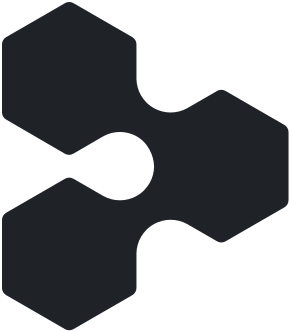
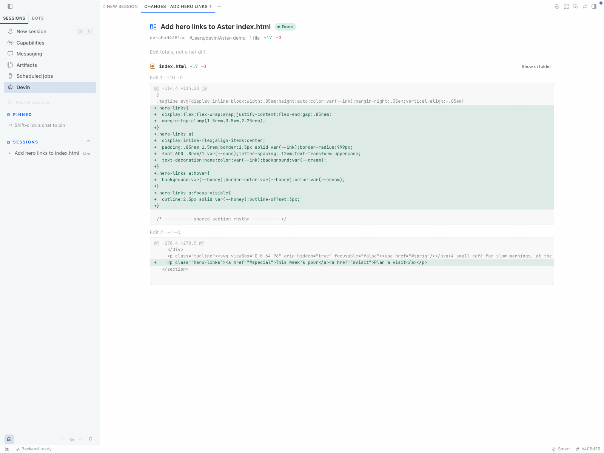

<div align="center">

  <a href="https://github.com/NousResearch/hermes-agent">
    
  </a>
  &nbsp;&nbsp;&nbsp;&nbsp;
  <a href="https://devin.ai">
    <picture>
      <source media="(prefers-color-scheme: dark)" srcset="assets/branding/devin-mark-dark.svg" />
      
    </picture>
  </a>

  <h1>Hermes × Devin</h1>

  <p><strong>Delegate coding tasks to Devin without leaving Hermes.</strong></p>

  <p>Run Devin on your computer or in the Cloud.<br />Choose an available model and review the work in your conversation.</p>

  <p>
    <a href="LICENSE"></a>
    <a href="docs/guides/cloud-sessions.md"></a>
    <a href="TRADEMARKS.md"></a>
  </p>

  <p><a href="#quick-start">Quick start</a> &nbsp;·&nbsp; <a href="docs/README.md">Documentation</a></p>

  <p><sub>Hermes Agent by <a href="https://nousresearch.com">Nous Research</a> · Devin by <a href="https://cognition.ai">Cognition</a>.<br />A community add-on, not an official product of either company.</sub></p>

</div>

<p align="center">
  
</p>

<p align="center"><sub>A real Local run in Hermes Desktop. Review shows recorded edits, not a net Git diff.</sub></p>

## Devin does the coding. Hermes keeps the conversation.

Ask Hermes to hand a task to Devin. The plugin sends the brief through the
[Devin CLI](https://cli.devin.ai), streams progress and returns the result to Hermes.
Use it in Hermes Desktop, the CLI, the TUI or the messaging gateway.

- **Choose where Devin works.** Local runs work in a folder on your computer.
  Cloud runs work in a remote environment with the account's available repositories.
- **Choose how Devin thinks.** Desktop discovers the models and controls your session
  advertises, including Fusion where available. Local and Cloud keep separate selections.
- **Follow the work in Desktop.** Live cards show Devin's plan, command output and file
  edits. Open Review changes or send a follow-up after a run finishes.
- **Approve launches through Hermes.** Local runs enforce your configured permission
  mode. Cloud runs require a separate Cloud-managed-permissions confirmation.

The plugin uses `devin acp` for Local and `devin acp --cloud` for Cloud.
No separate Cloud API key, extra service or Devin Desktop installation is required.
Hermes and the Devin CLI each need their own authentication.

## Local or Cloud

| | Local computer | Devin Cloud |
| --- | --- | --- |
| Workspace | Your selected folder | Remote repositories and platform choices |
| Models | Session-advertised models, Fusion pairings and supported thinking controls | Account-advertised Cloud presets and controls |
| Permissions | Your Local permission mode, with in-run approval where supported | Cloud-managed permissions, confirmed before launch |
| Stop | Cancel the task and clean up tracked Local processes | Request remote cancellation and show whether Devin confirmed it |

Cloud does not upload your local files or MCP servers. Stopping its local relay
does not prove remote work stopped. Read the [Cloud guide](docs/guides/cloud-sessions.md)
before your first Cloud run.

## Quick start

1. Install [Hermes Agent](https://hermes-agent.nousresearch.com/docs/getting-started/installation)
   and the [Devin CLI](https://cli.devin.ai). Configure Hermes' model provider.
2. Sign in to Devin and install the plugin from the Hermes plugin catalog:

   ```sh
   devin auth login
   hermes plugins install hermes-devin
   hermes plugins enable devin
   ```

   The catalog installs the reviewed commit, and `hermes plugins update devin`
   moves you to the next one.

3. Restart Hermes. In Desktop, enable the Desktop half under
   **Capabilities → Plugins → Devin**.
4. For Local ACP, choose a supported permission mode such as `accept-edits`.
   Current Devin builds cannot honor the default `normal` mode over ACP, so the
   plugin refuses those runs. See [installation and first-run settings](docs/getting-started/installation.md).
5. Run `/devin doctor` in a Hermes conversation, then ask:

   > Have Devin add tests for src/utils.py in /path/to/project and run them.

Or open **Devin → New Devin task** in Desktop to choose a target and its model controls.

## What it does on your computer

- **Runs the Devin CLI.** Each run starts `devin` from your PATH (or `cli_path`) as a
  child process. Local runs let Devin read and edit files and run shell commands in the
  chosen folder, within the permission mode you configured. Background runs keep going
  after the conversation turn ends, up to their timeout.
- **Talks to Devin's services.** Cloud runs and model discovery go through the Devin CLI
  to Cognition's servers. The plugin makes no other network calls and has no telemetry.
- **Uses Devin's own login.** The plugin never reads or stores credentials. Devin's child
  process gets your environment without Hermes' provider, bot and tool keys. Add any
  variable Devin needs with `extra_env`.
- **Keeps run history.** Run records, including prompts, plans, recorded diffs and
  command output, are saved under `<hermes home>/plugin-data/devin/runs/`. Set
  `persist_runs: false` and restart Hermes to keep history in memory only, and cap it
  with `history_limit`.

## Documentation

Detailed setup and technical references live in Markdown files under [`docs/`](docs/README.md).

| Start here | |
| --- | --- |
| [Installation](docs/getting-started/installation.md) | CLI setup, authentication and first-run configuration |
| [Usage](docs/getting-started/usage.md) | Desktop workflow, chat examples, commands and tools |
| [Local model controls](docs/guides/model-controls.md) | Model search, Fusion, thinking controls and defaults |
| [Cloud sessions](docs/guides/cloud-sessions.md) | Remote choices, permissions, Stop and reconnect checks |
| [Configuration](docs/reference/configuration.md) | Settings, defaults and limits |
| [Safety and limitations](docs/reference/approval-and-permissions.md) | Approval rules and links to known limitations |
| [All documentation](docs/README.md) | Development, run data, process cleanup and optional MCP setup |

## Community, credits and license

Hermes Devin is an independent community add-on. It is not affiliated with,
endorsed by, sponsored by or officially associated with Nous Research or Cognition.

[Hermes Agent](https://github.com/NousResearch/hermes-agent), its name and marks
belong to **Nous Research**. [Devin](https://devin.ai), its name and trioexagon mark
belong to **Cognition**. All rights to those products, names and marks remain
reserved to their respective owners.

The add-on's code is [MIT licensed](LICENSE). That license does not grant rights to
third-party products or marks. See [trademark credits and asset sources](TRADEMARKS.md).

Want to contribute? Start with [CONTRIBUTING.md](CONTRIBUTING.md).
